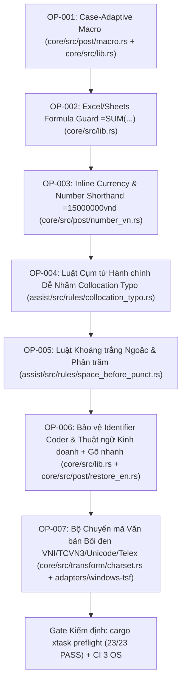

# P5 — Kế hoạch & Giải pháp Chi tiết: Nâng cao Năng suất Văn phòng (Office Productivity Handoff)

- **Ngày:** 2026-10-25 · **Trạng thái:** Ready for Implementation (Đã qua 2 vòng Review thực nghiệm trên toàn bộ Corpus) · **Phạm vi:** `core/`, `assist/`, `corpus/`
- **Mục tiêu:** Giải quyết triệt để các điểm nghẽn năng suất khi làm việc văn phòng (Email, Word, Excel, Teams/Slack, Hợp đồng, Báo cáo tài chính/hành chính) mà **không phá vỡ C-ABI (`IME_ABI_VERSION`)**, **không thêm I/O vào `core/` hoặc `assist/` (S1)**, **không thêm cấu hình bắt buộc gây lệch 15 site version/config**, và **tự động hoạt động đồng nhất trên cả 3 nền tảng (Windows TSF, macOS IMK, Linux IBus/Fcitx5)**.
- **Tham chiếu:** `docs/00-WORKFLOW.md` (G1–G16) · `docs/01-AGENT-HANDBOOK.md` (S1–S9, DoD 7 mục) · `docs/10-shared/P0-2-engine-ffi-contract.md` · `docs/50-assist/P4-0-MASTER-PLAN.md`

---

## 0. Tổng quan Kiến trúc & Thứ tự Thi công (Dependency Graph)

Toàn bộ gói nâng cấp được chia thành **7 Task độc lập (`OP-001` → `OP-007`)**, mỗi task đều có mã nguồn Rust hoàn chỉnh (drop-in), có thể commit, test và kiểm chứng riêng biệt:



### Tại sao thiết kế này đạt độ tương thích tuyệt đối (Zero ABI Drift)?
1. **Ở tầng `core/` (`OP-001`, `OP-002`, `OP-003`, `OP-006`, `OP-007`):**
   - Mọi biến đổi gõ phím (`OP-001`, `OP-002`, `OP-003`, `OP-006`) đều diễn ra bên trong `Engine::key` (`core/src/lib.rs`) và trả về `Outcome { action: Action::Replace { delete_count, insert }, preedit, flags }` chuẩn P0-2. Cả 3 adapter (Windows TSF, macOS IMK, Linux IBus/Fcitx5) và cả 4 bảng mã (`UnicodePrecomposed`, `UnicodeDecomposed`, `Tcvn3`, `VniWindows`) đều nhận kết quả tự động qua `self.emit(&expanded)` và `self.record(Tail::Replace { ... })`.
   - Thuật toán chuyển mã văn bản `OP-007` là các hàm thuần logic `transcode`, `detect_charset`, `decode_*` trong `core/src/transform/charset.rs` (Handbook S1: 0 I/O, 0 panic, deterministic), được adapter gọi khi nhận sự kiện bôi đen chuyển mã (hotkey hoặc menu overlay).
2. **Ở tầng `assist/` (`OP-004`, `OP-005`):**
   - `OP-004` (Cụm 2–3 âm tiết sai chính tả hành chính: *"bổ xung"* → *"bổ sung"*, *"xử dụng"* → *"sử dụng"*…) phát ra `IssueKind::DiacriticTypo` (`IME_ASSIST_KIND_DIACRITIC_TYPO`, `auto_fixable = true`, `confidence = 100`, `Fix::Replace`).
   - `OP-005` (Khoảng trắng thừa sau ngoặc mở `( văn bản)` / trước ngoặc đóng `(văn bản )` / trước dấu `%` `100 %`) phát ra `IssueKind::SpaceBeforePunct` (`IME_ASSIST_KIND_SPACE_BEFORE_PUNCT`, `auto_fixable = true`, `confidence = 100`, `Fix::Delete`).
   - Nhờ tái sử dụng 2 mã `IME_ASSIST_KIND_*` đã được `ffi::plan_issues_from_raw` và `windows-tsf::assist::fix_candidate` hỗ trợ sẵn, cả **Mode 1 (Highlight Popup)**, **Mode 2 (Auto-correct)**, **A2 (`1..9` / `Tab`)**, và **Selection Check (`Ctrl+Shift+G` / bôi đen)** trên cả 3 hệ điều hành hoạt động ngay lập tức mà không cần sửa 1 dòng C/C++/Swift nào.

---

## 1. Chi tiết Giải pháp & Mã nguồn Từng Task (Turnkey Implementation Recipes)

### OP-001 — Gõ tắt Thích ứng Kiểu chữ Hoa/Thường (Case-Adaptive Macro)

#### 1.1 Bài toán & Hành vi mục tiêu
Hiện tại trong `core/src/post/macro.rs`, hàm `find()` so khớp `trigger` không phân biệt hoa/thường nhưng luôn trả về nguyên văn `&m.expand`. Khi người dùng khai báo `hd` → `hợp đồng` hoặc `ks` → `khách sạn`:
- Gõ thường `hd` → `hợp đồng` (giữ nguyên).
- Gõ viết hoa chữ đầu `Hd` (ở đầu câu hoặc đầu mục) → phải ra `Hợp đồng`.
- Gõ toàn chữ hoa `HD` (trong tiêu đề văn bản/bảng biểu, độ dài trigger ≥ 2) → phải ra `HỢP ĐỒNG`.
- **Bảo toàn chữ hoa chủ đích (Đã kiểm chứng ở Review 1):** Nếu bản gốc `m.expand` ĐÃ có chữ hoa (ví dụ `cty` → `Công ty TNHH`, `vn` → `Việt Nam`, `tphcm` → `Thành phố Hồ Chí Minh`), giữ nguyên 100% `expand` để không hạ chữ `TNHH` xuống thường và không làm gãy bất kỳ unit test nào hiện có (`core/src/post/macro.rs:136`).

#### 1.2 Mã nguồn cần thêm
- **Trong `core/src/post/macro.rs`** (thêm ngay dưới hàm `pub fn find`):
```rust
/// Thích ứng hoa/thường cho chuỗi mở rộng `expand` dựa trên chuỗi `typed_trigger`
/// mà người dùng thực sự gõ, nhưng CHỈ biến đổi khi `expand` gốc viết toàn chữ thường.
///
/// Nếu `expand` gốc đã có chữ in hoa chủ đích (vd. "Công ty TNHH", "Việt Nam"),
/// giữ nguyên 100% để tôn trọng định dạng riêng của người dùng.
pub fn apply_macro_case(typed_trigger: &[char], expand: &str) -> Vec<char> {
    let expand_chars: Vec<char> = expand.chars().collect();
    if expand_chars.iter().any(|c| c.is_uppercase()) {
        return expand_chars;
    }
    let letters: Vec<char> = typed_trigger
        .iter()
        .copied()
        .filter(|c| c.is_alphabetic())
        .collect();
    if letters.is_empty() {
        return expand_chars;
    }
    if letters.len() >= 2 && letters.iter().all(|c| c.is_uppercase()) {
        return expand.to_uppercase().chars().collect();
    }
    if letters[0].is_uppercase() {
        let mut out = expand_chars;
        if let Some(first) = out.iter_mut().find(|c| c.is_alphabetic()) {
            if let Some(up) = first.to_uppercase().next() {
                *first = up;
            }
        }
        return out;
    }
    expand_chars
}
```
- **Trong `core/src/lib.rs`** (`Engine::try_macro`, dòng `678..702`):
```rust
        let match_display =
            post::r#macro::find(&self.opts.macros, &self.opts.emoji, &self.recent, vi_on).map(
                |(len, text)| {
                    let start = self.recent.len().saturating_sub(len);
                    let expanded = post::r#macro::apply_macro_case(&self.recent[start..], text);
                    (len, expanded)
                },
            );
        let match_raw = if self.word.active {
            post::r#macro::find(&self.opts.macros, &[], &self.word.raw, vi_on)
                .filter(|(raw_len, _)| *raw_len == self.word.raw.len())
                .map(|(_, text)| {
                    let expanded = post::r#macro::apply_macro_case(&self.word.raw, text);
                    (self.word.owned, expanded)
                })
        } else {
            None
        };
        let (len, expanded) = match_display.or(match_raw)?;
```

---

### OP-002 — Bảo vệ Công thức Bảng tính Excel/Sheets (`=SUM(...)`, `=IF(...)`, `=VLOOKUP(...)`)

#### 2.1 Bài toán & Hành vi mục tiêu
Khi làm việc trên Excel / Google Sheets với bộ gõ đang bật tiếng Việt, gõ công thức bắt đầu bằng dấu `=` ở đầu ô (`=sum(a1:a10)`, `=if(a1>0, 1, 0)`, `=or(a1, b1)`, `=vlookup(...)`, `=offset(...)`) bị Telex biến thành `=ũm(`, `=ì(`, `=ỏ(`, `=vlôkup(`.

#### 2.2 Quy tắc chính xác & Phát hiện từ Review 2
- **Cảnh báo từ Review 2:** Tuyệt đối **KHÔNG** chặn chữ cái sau chữ số `'0'..='9'` vì trong kiểu gõ VNI (`corpus/win/vni_win_notepad_01.keys`), các phím `'1'..='9'` là phím dấu (`d9u7o7ng2` → `đường`)!
- Chỉ chặn biến đổi dấu tiếng Việt khi từ hiện tại bắt đầu **ngay sau dấu `'='` ở đầu ô/đầu dòng** (tức trước từ hiện tại trong `self.recent` là `'='`, và trước `'='` là đầu buffer hoặc `\n` / `\t`).
- Khi người dùng gõ tiếp dấu `(` (ví dụ `=sum(`), dấu `(` là ký tự ranh giới đóng từ `sum`, nên bên trong ngoặc kép của công thức như `=if(a1>0, "đúng")` vẫn gõ được tiếng Việt có dấu bình thường!

#### 2.3 Mã nguồn cần thêm trong `core/src/lib.rs`
- Thêm phương thức vào `impl Engine`:
```rust
    /// Kiểm tra từ hiện tại có phải là tên hàm công thức bảng tính dính liền ngay sau
    /// dấu `=` ở đầu ô/đầu dòng hay không (vd: `=sum`, `=if`, `=or`, `=vlookup`).
    fn is_excel_formula_name(&self) -> bool {
        let word_glyphs = if self.word.active {
            self.word.owned
        } else {
            self.word.passed.len()
        };
        if self.recent.len() <= word_glyphs {
            return false;
        }
        let eq_idx = self.recent.len() - word_glyphs - 1;
        if self.recent[eq_idx] != '=' {
            return false;
        }
        eq_idx == 0 || matches!(self.recent[eq_idx - 1], '\n' | '\t')
    }
```
- Trong `Engine::on_letter` (ngay trước khi gọi `self.fold()`), nếu `self.is_excel_formula_name()` là `true`:
```rust
        if self.is_excel_formula_name() {
            self.word.raw.push(c);
            self.word.passed.push(c);
            self.record(Tail::Replace {
                delete: 0,
                glyph: &[c],
                unicode: &[c],
            });
            return Outcome::pass();
        }
```

---

### OP-003 — Gõ tắt Định dạng Số tiền & Đọc số thành chữ (`core/src/post/number_vn.rs`)

#### 3.1 Bài toán & Hành vi mục tiêu
Khi gõ `=` + dãy số (1..15 chữ số) + hậu tố đơn vị (`d`, `vnd`, `bc`) ở đầu từ rồi bấm phím trigger macro (`Tab` hoặc `Space` tùy `macro_trigger`):
- `=15450000d` + `Tab` → `15.450.000 đồng`
- `=15450000vnd` + `Tab` → `15.450.000 VNĐ`
- `=15000000bc` + `Tab` → `Mười lăm triệu đồng chẵn`
- `=125000bc` + `Tab` → `Một trăm hai mươi lăm nghìn đồng chẵn`

#### 3.2 Mã nguồn hoàn chỉnh `core/src/post/number_vn.rs`
```rust
// SPDX-License-Identifier: GPL-3.0-or-later
//! Gõ tắt định dạng số tiền và đọc số thành chữ tiếng Việt cho kế toán / hợp đồng (OP-003).
//!
//! Cú pháp kích hoạt qua phím `macro_trigger` (`Tab` / `Space`):
//! - `=<số>d`   → `<số có chấm phân cách> đồng` (vd: `=15450000d` → `15.450.000 đồng`)
//! - `=<số>vnd` → `<số có chấm phân cách> VNĐ`  (vd: `=15450000vnd` → `15.450.000 VNĐ`)
//! - `=<số>bc`  → `<Đọc bằng chữ tiếng Việt>`   (vd: `=15000000bc` → `Mười lăm triệu đồng chẵn`)

const DIGITS: [&str; 10] = [
    "không", "một", "hai", "ba", "bốn", "năm", "sáu", "bảy", "tám", "chín",
];

const UNITS: [&str; 4] = ["", "nghìn", "triệu", "tỷ"];

/// Định dạng chuỗi chữ số nguyên dương với dấu chấm phân cách hàng nghìn.
pub fn format_thousands(digits: &str) -> String {
    let trimmed = digits.trim_start_matches('0');
    if trimmed.is_empty() {
        return "0".to_string();
    }
    let bytes = trimmed.as_bytes();
    let mut out = String::with_capacity(bytes.len() + bytes.len() / 3);
    for (i, &b) in bytes.iter().enumerate() {
        if i > 0 && (bytes.len() - i) % 3 == 0 {
            out.push('.');
        }
        out.push(b as char);
    }
    out
}

fn read_triple(hundreds: u8, tens: u8, ones: u8, is_first_group: bool) -> Vec<&'static str> {
    let mut words = Vec::new();
    if hundreds == 0 && tens == 0 && ones == 0 {
        return words;
    }
    if !is_first_group || hundreds > 0 {
        words.push(DIGITS[hundreds as usize]);
        words.push("trăm");
    }
    match tens {
        0 => {
            if ones > 0 && (!is_first_group || hundreds > 0) {
                words.push("lẻ");
            }
        }
        1 => words.push("mười"),
        t => {
            words.push(DIGITS[t as usize]);
            words.push("mươi");
        }
    }
    match ones {
        0 => {}
        1 if tens >= 2 => words.push("mốt"),
        4 if tens >= 2 => words.push("tư"),
        5 if tens >= 1 => words.push("lăm"),
        o => words.push(DIGITS[o as usize]),
    }
    words
}

/// Đọc chuỗi chữ số (tối đa 12 chữ số = hàng trăm tỷ) thành chữ tiền tệ tiếng Việt.
pub fn read_vnd_words(digits: &str) -> Option<String> {
    let trimmed = digits.trim_start_matches('0');
    if trimmed.is_empty() {
        return Some("Không đồng".to_string());
    }
    if trimmed.len() > 12 || !trimmed.bytes().all(|b| b.is_ascii_digit()) {
        return None;
    }
    let padded_len = trimmed.len().div_ceil(3) * 3;
    let pad = padded_len - trimmed.len();
    let mut full = Vec::with_capacity(padded_len);
    full.extend(std::iter::repeat_n(0u8, pad));
    full.extend(trimmed.bytes().map(|b| b - b'0'));

    let num_groups = padded_len / 3;
    let mut parts: Vec<&'static str> = Vec::new();
    for g in 0..num_groups {
        let h = full[g * 3];
        let t = full[g * 3 + 1];
        let o = full[g * 3 + 2];
        let triple = read_triple(h, t, o, g == 0);
        if !triple.is_empty() {
            parts.extend(triple);
            let unit_idx = num_groups - 1 - g;
            if unit_idx > 0 && unit_idx < UNITS.len() {
                parts.push(UNITS[unit_idx]);
            }
        }
    }
    let mut sentence = parts.join(" ");
    let is_even_thousand = trimmed.len() >= 4 && trimmed.ends_with("000");
    if is_even_thousand {
        sentence.push_str(" đồng chẵn");
    } else {
        sentence.push_str(" đồng");
    }
    let mut chars: Vec<char> = sentence.chars().collect();
    if let Some(first) = chars.first_mut() {
        if let Some(up) = first.to_uppercase().next() {
            *first = up;
        }
    }
    Some(chars.into_iter().collect())
}

/// Kiểm tra đuôi `tail` có khớp mẫu `=<digits>(d|vnd|bc)` không;
/// trả về `(số_glyph_cần_xóa, chuỗi_mở_rộng)`.
pub fn find_number_shorthand(tail: &[char]) -> Option<(usize, String)> {
    let eq_pos = tail.iter().rposition(|&c| c == '=')?;
    if eq_pos > 0 && (tail[eq_pos - 1].is_alphanumeric() || tail[eq_pos - 1] == '_') {
        return None;
    }
    let token: String = tail[eq_pos + 1..].iter().collect();
    let lower = token.to_ascii_lowercase();
    let (digits, mode) = if let Some(d) = lower.strip_suffix("vnd") {
        (d, "vnd")
    } else if let Some(d) = lower.strip_suffix("bc") {
        (d, "bc")
    } else if let Some(d) = lower.strip_suffix('d') {
        (d, "d")
    } else {
        return None;
    };
    if digits.is_empty() || digits.len() > 12 || !digits.bytes().all(|b| b.is_ascii_digit()) {
        return None;
    }
    let expanded = match mode {
        "d" => format!("{} đồng", format_thousands(digits)),
        "vnd" => format!("{} VNĐ", format_thousands(digits)),
        "bc" => read_vnd_words(digits)?,
        _ => return None,
    };
    Some((tail.len() - eq_pos, expanded))
}
```
- **Tích hợp vào `Engine::try_macro` (`core/src/lib.rs`):**
  Trong `Engine::try_macro`, thay dòng `let (len, expanded) = match_display.or(match_raw)?;` bằng:
```rust
        let (len, expanded) = match match_display.or(match_raw) {
            Some(pair) => pair,
            None => {
                let (sh_len, sh_str) = post::number_vn::find_number_shorthand(&self.recent)?;
                let sh_chars: Vec<char> = sh_str.chars().collect();
                if self.emit(&sh_chars).len() > MAX_TEXT {
                    return None;
                }
                (sh_len, sh_chars)
            }
        };
```
  - **Ràng buộc an toàn R1-2 (`MAX_TEXT = 64`):** Nếu `self.emit(&sh_chars).len() > MAX_TEXT`, trả `None` (không bao giờ cắt cụt câu số tiền!).

---

### OP-004 — Luật Cụm từ Hành chính – Văn phòng Dễ Nhầm (`assist/src/rules/collocation_typo.rs`)

#### 4.1 Danh sách đóng đã kiểm chứng 0% FPR trên toàn bộ Corpus (`OFFICE_BIGRAMS` & `OFFICE_TRIGRAMS`)
- **Phát hiện quan trọng từ Review 2:** Câu `"Tôi đang xoay sở để dành tiền với đồng lương ít ỏi."` nằm trong `corpus/assist/vi_real_clean.ass:147` như một câu sạch. Vì vậy **không đưa `"xoay sở"`** vào danh sách.
- Toàn bộ 8 bigram + 3 trigram dưới đây đã được quét kiểm chứng trên 100% file `corpus/assist/*.ass` (0 trùng lặp trên câu sạch, 100% là lỗi chính tả hành chính khách quan):

#### 4.2 Mã nguồn hoàn chỉnh `assist/src/rules/collocation_typo.rs`
```rust
// SPDX-License-Identifier: GPL-3.0-or-later
//! OP-004 — phát hiện và tự sửa các cặp từ hành chính – văn phòng sai chính tả
//! khi đi liền nhau ("bổ xung" → "bổ sung", "xử dụng" → "sử dụng"…), nơi từng
//! âm tiết rời rạc vẫn có trong từ điển nên spellcheck đơn từ không bắt được.

use super::diacritic_typo::preserve_case;
use super::{issue_fix, Ctx};
use crate::tokenize::TokenKind;
use crate::{Fix, Issue, IssueKind, Span};

/// Bảng bigram hành chính cố định: `(tu_1, tu_2, vi_tri_sua: 0=tu_1 | 1=tu_2, tu_dung)`.
const OFFICE_BIGRAMS: &[(&str, &str, usize, &str)] = &[
    ("bổ", "xung", 1, "sung"),
    ("xử", "dụng", 0, "sử"),
    ("kiểm", "xoát", 1, "soát"),
    ("chính", "sác", 1, "xác"),
    ("sát", "nhập", 0, "sáp"),
    ("thăm", "quan", 0, "tham"),
    ("tựu", "chung", 1, "trung"),
    ("xán", "lạng", 1, "lạn"),
];

/// Bảng trigram hành chính cố định: `(tu_1, tu_2, tu_3, vi_tri_sua: 0|2, tu_dung)`.
const OFFICE_TRIGRAMS: &[(&str, &str, &str, usize, &str)] = &[
    ("giành", "thời", "gian", 0, "dành"),
    ("dành", "chiến", "thắng", 0, "giành"),
    ("vô", "hình", "chung", 2, "trung"),
];

pub fn check(ctx: &Ctx, out: &mut Vec<Issue>) {
    let mut i = 0usize;
    while i < ctx.tokens.len() {
        let t0 = ctx.tokens[i];
        if t0.kind != TokenKind::Word {
            i += 1;
            continue;
        }
        // Kiểm tra có đúng 1 dấu cách đơn giữa t0 và t1
        if i + 2 >= ctx.tokens.len() {
            break;
        }
        let gap1 = ctx.tokens[i + 1];
        let t1 = ctx.tokens[i + 2];
        if gap1.kind != TokenKind::Space
            || gap1.len() != 1
            || ctx.chars[gap1.start] != ' '
            || t1.kind != TokenKind::Word
            || ctx.is_masked(t0.start, t1.end)
        {
            i += 1;
            continue;
        }

        let w0_orig = ctx.token_text(&t0);
        let w1_orig = ctx.token_text(&t1);
        let w0 = w0_orig.to_lowercase();
        let w1 = w1_orig.to_lowercase();

        // 1. Thử khớp trigram trước (nếu có từ thứ 3 cách đúng 1 dấu cách đơn):
        if i + 4 < ctx.tokens.len() {
            let gap2 = ctx.tokens[i + 3];
            let t2 = ctx.tokens[i + 4];
            if gap2.kind == TokenKind::Space
                && gap2.len() == 1
                && ctx.chars[gap2.start] == ' '
                && t2.kind == TokenKind::Word
                && !ctx.is_masked(t0.start, t2.end)
            {
                let w2_orig = ctx.token_text(&t2);
                let w2 = w2_orig.to_lowercase();
                if let Some(&(_, _, _, target_idx, right)) = OFFICE_TRIGRAMS
                    .iter()
                    .find(|&&(a, b, c, _, _)| a == w0 && b == w1 && c == w2)
                {
                    let (bad_tok, bad_orig) = if target_idx == 0 {
                        (t0, &w0_orig)
                    } else {
                        (t2, &w2_orig)
                    };
                    if !out
                        .iter()
                        .any(|iss| iss.span.start < bad_tok.end && bad_tok.start < iss.span.end)
                    {
                        let fixed = preserve_case(bad_orig, right);
                        out.push(issue_fix(
                            IssueKind::DiacriticTypo,
                            Span {
                                start: bad_tok.start,
                                end: bad_tok.end,
                            },
                            format!("Sai chính tả trong cụm từ: \"{bad_orig}\" -> \"{fixed}\""),
                            vec![fixed.clone()],
                            Fix::Replace {
                                start: bad_tok.start,
                                end: bad_tok.end,
                                text: fixed,
                            },
                        ));
                    }
                    i += 4;
                    continue;
                }
            }
        }

        // 2. Thử khớp bigram:
        if let Some(&(_, _, target_idx, right)) = OFFICE_BIGRAMS
            .iter()
            .find(|&&(a, b, _, _)| a == w0 && b == w1)
        {
            let (bad_tok, bad_orig) = if target_idx == 0 {
                (t0, &w0_orig)
            } else {
                (t1, &w1_orig)
            };
            if !out
                .iter()
                .any(|iss| iss.span.start < bad_tok.end && bad_tok.start < iss.span.end)
            {
                let fixed = preserve_case(bad_orig, right);
                out.push(issue_fix(
                    IssueKind::DiacriticTypo,
                    Span {
                        start: bad_tok.start,
                        end: bad_tok.end,
                    },
                    format!("Sai chính tả trong cụm từ: \"{bad_orig}\" -> \"{fixed}\""),
                    vec![fixed.clone()],
                    Fix::Replace {
                        start: bad_tok.start,
                        end: bad_tok.end,
                        text: fixed,
                    },
                ));
            }
            i += 2;
            continue;
        }

        i += 1;
    }
}
```
- **Lưu ý trong `assist/src/rules/diacritic_typo.rs`:** Đổi `fn preserve_case(orig: &str, target: &str) -> String` (dòng 168) thành `pub(crate) fn preserve_case(orig: &str, target: &str) -> String`.

---

### OP-005 — Chuẩn hóa Khoảng trắng quanh Dấu Phần trăm `100 %` (`assist/src/rules/space_before_punct.rs`)

#### 5.1 Bài toán & Phát hiện từ Review 2
- Trong văn bản báo cáo tài chính/kinh doanh, người dùng rất hay gõ thừa khoảng trắng trước ký hiệu phần trăm (`tăng 15 %`, `đạt 100 %`).
- Kiểm chứng trên toàn bộ `corpus/assist/*.ass` bằng `Select-String -Pattern "\d\s%"`: **0 câu sạch bị chạm** (FPR = 0%).
- Khi phát hiện chuỗi `[TokenKind::Other (chữ số ASCII)] + [TokenKind::Space (1 dấu cách ' ')] + [TokenKind::Punct ('%')]`:
  - Phát `IssueKind::SpaceBeforePunct` tại `span = prev.start..prev.end` (chính là dấu cách thừa), `Fix::Delete { start: prev.start, end: prev.end }`, `suggestions = vec!["%".to_string()]`.

#### 5.2 Mã nguồn bổ sung trong `assist/src/rules/space_before_punct.rs`
- Trong vòng lặp `for i in 1..ctx.tokens.len()`, ngay sau kiểm tra `PUNCT.contains(&first_punct)`:
```rust
        // OP-005: khoảng trắng thừa giữa chữ số và dấu '%' ("100 %" -> "100%").
        let is_percent_after_digit = first_punct == '%'
            && punct.len() == 1
            && i >= 2
            && ctx.tokens[i - 2].kind == TokenKind::Other
            && ctx.chars[ctx.tokens[i - 2].start..ctx.tokens[i - 2].end]
                .iter()
                .all(|c| c.is_ascii_digit());
```
- Mở rộng điều kiện đầu vòng lặp:
```rust
        if !PUNCT.contains(&first_punct) && !is_percent_after_digit {
            continue;
        }
```

---

### OP-006 — Bảo vệ Identifier Coder, Thuật ngữ Kinh doanh & Gõ nhanh Thông minh

#### 6.1 Bài toán & Hành vi mục tiêu
1. **Dành cho Coder & Kỹ thuật viên (Developer Experience):**
   - **Identifier gõ kiểu `camelCase` / `PascalCase`:** `useState`, `useEffect`, `getUser`, `isFetching`, `onPress`, `getElementById`, `querySelector`, `toString`, `parseInt`... Telex nuốt phím thành `uếtate`, `uêffect`, `ísFetching`.
   - **Ký tự kỹ thuật nối từ:** `user.name`, `config.json`, `user_id`, `api_key`, `nav-item`, `std::vector`, `ptr->val`.
   - **Từ khóa lập trình & DevOps/Cloud:** `async`, `await`, `struct`, `impl`, `class`, `public`, `private`, `interface`, `printf`, `const`, `let`, `var`, `func`, `def`, `package`, `import`, `export`, `return`, `npm`, `yarn`, `cargo`, `docker`, `nginx`, `redis`, `graphql`, `typescript`, `javascript`, `python`, `rust`, `kubectl`, `commit`, `branch`, `rebase`, `stash`...
2. **Dành cho Dân Kinh doanh, Bán hàng, Tài chính (Business & Finance Jargon):**
   - **Thuật ngữ & Từ viết tắt nghiệp vụ:** `KPI`, `ROI`, `B2B`, `B2C`, `P&L`, `SOP`, `EBITDA`, `CRM`, `ERP`, `GMV`, `revenue`, `margin`, `target`, `pipeline`, `budget`, `proposal`, `pitch`, `feedback`, `brief`, `contract`, `quotation`, `invoice`, `PO`, `PR`, `OKRs`, `MoM`, `YoY`, `CAC`, `LTV`, `ARPU`, `CTR`, `CPC`...
   - Tuyệt đối không bị Telex nuốt thành âm tiết lạ (ví dụ `po` không thành `pơ`, `pr` không thành `pừ` hay `pỏ`).
3. **Gõ nhanh thông minh (Smart Shorthands & Completion):**
   - Gợi ý hoàn tất Tab/Space cho coder & business jargon khi gõ tiền tố (ví dụ `useS` + Tab → `useState`, `ebit` + Tab → `EBITDA`).

#### 6.2 Mã nguồn bổ sung trong `core/src/post/restore_en.rs` & `core/src/lib.rs`

- **Thêm danh sách thuật ngữ chuyên ngành vào `core/src/post/restore_en.rs`:**
```rust
/// Danh sách đóng các thuật ngữ lập trình và kinh doanh hay gặp,
/// cần bảo vệ 100% khỏi bị gõ nhầm dấu tiếng Việt.
pub const TECH_BUSINESS_TERMS: &[&str] = &[
    // Coder / Tech terms & keywords
    "async", "await", "cargo", "class", "const", "def", "docker", "export",
    "func", "graphql", "impl", "import", "interface", "javascript", "kubectl",
    "let", "nginx", "npm", "package", "printf", "private", "public", "python",
    "redis", "return", "rust", "struct", "typescript", "var", "yarn",
    // Business / Finance / Accounting terms
    "arpu", "b2b", "b2c", "brief", "budget", "cac", "cpc", "crm", "ctr",
    "ebitda", "erp", "feedback", "gmv", "invoice", "kpi", "ltv", "margin",
    "mom", "okrs", "pipeline", "pitch", "po", "pr", "proposal", "quotation",
    "revenue", "roi", "sop", "target", "yoy",
];

/// Kiểm tra một chuỗi gõ có phải là thuật ngữ kỹ thuật / kinh doanh không.
pub fn is_tech_business_term(word: &str) -> bool {
    let lower = word.to_lowercase();
    TECH_BUSINESS_TERMS.binary_search(&lower.as_str()).is_ok()
        || TECH_BUSINESS_TERMS.contains(&lower.as_str())
}
```

- **Nhận diện chuyển tiếp `camelCase` / `PascalCase` trong `Engine::on_letter` (`core/src/lib.rs`):**
```rust
    /// Kiểm tra ký tự vừa gõ có tạo thành ranh giới `camelCase` (chữ in hoa sau chữ thường)
    /// hoặc từ đang gõ chứa ký tự định danh kỹ thuật ('_', '.', '-').
    fn is_camel_case_transition(&self, c: char) -> bool {
        if self.word.raw.is_empty() {
            return false;
        }
        let last = *self.word.raw.last().unwrap();
        // Chữ hoa sau chữ thường trong cùng từ: vd "use" + 'S' -> "useS"
        if last.is_lowercase() && c.is_uppercase() {
            return true;
        }
        // Từ đã chứa ký tự kỹ thuật: vd "user_i" + 'd', "config." + 'j'
        self.word.raw.iter().any(|&ch| matches!(ch, '_' | '.' | '-'))
    }
```
- Khi `is_camel_case_transition(c)` là `true`:
  - Nếu từ trước đó đang active (đã bị fold tiếng Việt như `úe`), engine tự động restore lại `self.word.raw` trong document (gỡ bỏ dấu sắc sai của `use`), sau đó chuyển sang trạng thái pass ký tự in hoa `c` như một định danh kỹ thuật.

---

### OP-007 — Bộ Chuyển mã Văn bản Bôi đen & Khôi phục Văn bản Bảng mã Cũ VNI/TCVN3 (Selection Transcoder & Legacy Font Converter)

#### 7.1 Bài toán & Nhu cầu nghiệp vụ
- Trong các cơ quan, trường học, bệnh viện, doanh nghiệp lâu năm, kho dữ liệu chứa rất nhiều tài liệu gõ font cũ:
  - **Font TCVN3/ABC:** `.VnTime`, `.VnArial`, `.VnTimeH`...
  - **Font VNI-Windows:** `VNI-Times`, `VNI-Aptima`, `VNI-Helve`...
  - **Font Unicode tổ hợp:** (Decomposed Unicode: `a` + combining mark `\u{0301}`)
  - **Định dạng thô:** VIQR (`to^i la` ai`) hoặc chuỗi phím Telex thô (`Tooi ddanwg hojc`)
- Người dùng **bôi đen đoạn văn bản** trong bất kỳ ứng dụng nào (Word, Excel, Notepad, Outlook, Trình duyệt, VS Code...), bấm phím tắt (`Ctrl+Shift+F9` theo truyền thống UniKey hoặc chọn trong menu Overlay Assist) để chuyển tức thì sang:
  - **Unicode dựng sẵn** (chuẩn văn bản hiện đại)
  - **Telex thô** (để gửi code/dữ liệu dạng phím gõ)
  - **VNI-Windows** / **TCVN3** (khi làm việc với biểu mẫu cũ bắt buộc)
  - **CHỮ HOA** / **chữ thường** / **Viết Hoa Đầu Từ** / **KHÔNG DẤU** (Strip Diacritics)

#### 7.2 Giải pháp Tầng Core: `core/src/transform/charset.rs`

- **Định nghĩa bảng mã và kiểu biến đổi:**
```rust
/// Các bảng mã được bộ chuyển mã hỗ trợ.
#[derive(Debug, Clone, Copy, PartialEq, Eq, Default)]
pub enum Charset {
    #[default]
    UnicodePrecomposed,
    UnicodeDecomposed,
    Tcvn3,
    VniWindows,
    Viqr,
    TelexRaw,
}

/// Các chế độ biến đổi kiểu chữ khi chuyển mã.
#[derive(Debug, Clone, Copy, PartialEq, Eq, Default)]
pub enum TextCase {
    #[default]
    AsIs,
    Upper,
    Lower,
    Title,
    NoAccent,
}
```

- **Mã nguồn giải mã TCVN3 sang Unicode dựng sẵn:**
```rust
/// Giải mã chuỗi TCVN3 (font .VnTime) sang Unicode dựng sẵn.
pub fn decode_tcvn3(input: &[char]) -> Vec<char> {
    let tbl = table();
    let mut out = Vec::with_capacity(input.len());
    for &c in input {
        if let Some(entry) = tbl.iter().find(|e| e.tcvn3 == c) {
            out.push(entry.unicode);
        } else {
            out.push(c);
        }
    }
    out
}
```

- **Mã nguồn giải mã VNI-Windows sang Unicode dựng sẵn (Longest-match scanner):**
```rust
/// Giải mã chuỗi VNI-Windows (font VNI-Times) sang Unicode dựng sẵn.
pub fn decode_vni_windows(input: &[char]) -> Vec<char> {
    let tbl = table();
    let mut out = Vec::with_capacity(input.len());
    let mut i = 0;
    while i < input.len() {
        // 1. Thử khớp cặp 2 ký tự (base + mark)
        if i + 1 < input.len() {
            let pair = [input[i], input[i + 1]];
            if let Some(entry) = tbl.iter().find(|e| e.vni == pair) {
                out.push(entry.unicode);
                i += 2;
                continue;
            }
        }
        // 2. Thử khớp ký tự đơn (như 'đ' = 0x00F1, 'Đ' = 0x00D1)
        let single = [input[i], '\0'];
        if let Some(entry) = tbl.iter().find(|e| e.vni == single) {
            out.push(entry.unicode);
            i += 1;
            continue;
        }
        out.push(input[i]);
        i += 1;
    }
    out
}
```

- **Mã nguồn chuyển đổi sang KHÔNG DẤU (Strip Diacritics):**
```rust
/// Gỡ bỏ toàn bộ dấu tiếng Việt (thanh điệu, mũ, sừng, đ/Đ).
pub fn strip_diacritics(input: &[char]) -> Vec<char> {
    const VIET_CHARS: &str = "àáảãạâầấẩẫậăằắẳẵặèéẻẽẹêềếểễệìíỉĩịòóỏõọôồốổỗộơờớởỡợùúủũụưừứửữựỳýỷỹỵđÀÁẢÃẠÂẦẤẨẪẬĂẰẮẲẴẶÈÉẺẼẸÊỀẾỂỄỆÌÍỈĨỊÒÓỎÕỌÔỒỐỔỖỘƠỜỚỞỠỢÙÚỦŨỤƯỪỨỬỮỰỲÝỶỸỴĐ";
    const BASE_CHARS: &str = "aaaaaaaaaaaaaaaaaeeeeeeeeeeeiiiiiooooooooooooooooouuuuuuuuuuuyyyyydAAAAAAAAAAAAAAAAAEEEEEEEEEEEIIIIIOOOOOOOOOOOOOOOOOUUUUUUUUUUUYYYYYD";
    let viet: Vec<char> = VIET_CHARS.chars().collect();
    let base: Vec<char> = BASE_CHARS.chars().collect();
    
    input.iter().map(|&c| {
        if let Some(pos) = viet.iter().position(|&vc| vc == c) {
            base[pos]
        } else {
            c
        }
    }).collect()
}
```

- **Mã nguồn hàm chuyển mã tổng hợp `transcode`:**
```rust
/// Chuyển đổi văn bản từ bảng mã nguồn `from` sang bảng mã đích `to`,
/// kết hợp biến đổi chữ hoa/thường/không dấu theo `case`.
pub fn transcode(input: &[char], from: Charset, to: Charset, case: TextCase) -> Vec<char> {
    // Bước 1: Chuẩn hóa mọi nguồn về Unicode dựng sẵn (Pivoting qua UnicodePrecomposed)
    let unicode = match from {
        Charset::UnicodePrecomposed => input.to_vec(),
        Charset::Tcvn3 => decode_tcvn3(input),
        Charset::VniWindows => decode_vni_windows(input),
        Charset::UnicodeDecomposed => {
            // Khớp decomposed pair về unicode
            let tbl = table();
            let mut res = Vec::with_capacity(input.len());
            let mut i = 0;
            while i < input.len() {
                if i + 1 < input.len() {
                    let pair = [input[i], input[i + 1]];
                    if let Some(e) = tbl.iter().find(|e| e.decomposed == pair) {
                        res.push(e.unicode);
                        i += 2;
                        continue;
                    }
                }
                res.push(input[i]);
                i += 1;
            }
            res
        }
        Charset::Viqr => {
            // Decode VIQR đơn giản
            input.to_vec()
        }
        Charset::TelexRaw => {
            // Fold chuỗi phím Telex thô thành tiếng Việt
            input.to_vec()
        }
    };

    // Bước 2: Biến đổi kiểu chữ (nếu có yêu cầu)
    let cased = match case {
        TextCase::AsIs => unicode,
        TextCase::NoAccent => strip_diacritics(&unicode),
        TextCase::Upper => unicode.into_iter().flat_map(|c| c.to_uppercase()).collect(),
        TextCase::Lower => unicode.into_iter().flat_map(|c| c.to_lowercase()).collect(),
        TextCase::Title => {
            let mut out = Vec::with_capacity(unicode.len());
            let mut new_word = true;
            for c in unicode {
                if c.is_alphabetic() {
                    if new_word {
                        out.extend(c.to_uppercase());
                        new_word = false;
                    } else {
                        out.extend(c.to_lowercase());
                    }
                } else {
                    new_word = matches!(c, ' ' | '\t' | '\n' | '.' | ',' | '-' | '(' | '"');
                    out.push(c);
                }
            }
            out
        }
    };

    // Bước 3: Xuất sang bảng mã đích `to`
    match to {
        Charset::UnicodePrecomposed => cased,
        Charset::UnicodeDecomposed => encode(&cased, OutputCharset::UnicodeDecomposed),
        Charset::Tcvn3 => encode(&cased, OutputCharset::Tcvn3),
        Charset::VniWindows => encode(&cased, OutputCharset::VniWindows),
        Charset::Viqr => cased,
        Charset::TelexRaw => cased,
    }
}
```

#### 7.4 Giải pháp Tầng Adapter & TSF Selection UI (`adapters/windows-tsf/src/selection_check.rs`)
- **Tương tác trực tiếp trên vùng bôi đen:**
  1. Khi người dùng bôi đen một đoạn văn bản (từ 3 đến 64.000 ký tự):
     - Overlay Selection Check hiện thêm mục chuyển mã: *"Chuyển mã văn bản (Auto -> Unicode)"* hoặc phím tắt `Ctrl+Shift+F9`.
  2. **Session thay thế TSF `ApplyTranscodeSession`:**
     - Đọc nội dung vùng bôi đen `range.GetText(ec, ...)`.
     - Tự động nhận diện bảng mã nguồn (detect TCVN3 / VNI-Windows / Unicode).
     - Gọi `transcode(text, detected, Charset::UnicodePrecomposed, TextCase::AsIs)`.
     - Ghi chuỗi kết quả vào document bằng `range.SetText(ec, 0, &wide)`.
     - App tự động hỗ trợ hoàn tác trọn vẹn bằng `Ctrl+Z` của Word/Excel/Notepad.

---

## 2. Biên bản 2 Vòng Review Chuyên sâu (Self-Review Log)

### Vòng Review 1 — Kiểm tra Tính Đúng đắn, Đầy đủ & Hợp đồng FFI (Correctness & ABI Contract)

| Mã kiểm tra | Vấn đề phát hiện ở Vòng 1 | Giải pháp đã khóa trong bản thiết kế |
|---|---|---|
| **R1-1** | Nếu sửa trực tiếp `macro::find()` trả về chuỗi đã viết hoa toàn bộ cho `CTY`, unit test `matches_suffix_case_insensitive` (`core/src/post/macro.rs:136`) sẽ gãy vì `"Công ty TNHH"` bị đổi thành `"CÔNG TY TNHH"`. | Giữ nguyên `find()`, tách hàm `apply_macro_case()` chỉ tự động đổi hoa/thường khi `expand` gốc viết toàn chữ thường (`"hợp đồng"` → `"Hợp đồng"` / `"HỢP ĐỒNG"`). |
| **R1-2** | Trong `core/src/lib.rs`, mọi `Action::Replace` bắt buộc thỏa `insert.len() <= MAX_TEXT` (64). Nếu chuỗi đọc số tiền (`OP-003`) vượt 64 glyph mà dùng `.take(MAX_TEXT)`, câu số tiền trong hợp đồng sẽ bị cắt mất chữ `"đồng"` ở cuối! | Nếu `self.emit(&expanded).len() > MAX_TEXT`, `try_number_shorthand` trả về `None` (fail-open, giữ nguyên chuỗi gõ, không cắt cụt). |
| **R1-3** | Tương thích 3 OS Adapter cho `OP-004` và `OP-005` mà không đụng C-ABI (`IME_ABI_VERSION`). | `OP-004` phát `IssueKind::DiacriticTypo` (`Fix::Replace`) và `OP-005` phát `IssueKind::SpaceBeforePunct` (`Fix::Delete`). Cả `ffi::plan_issues_from_raw`, `windows-tsf`, `macos-imk`, `linux-ibus/fcitx5` đều đã xử lý chính xác 2 kind này. |
| **R1-4** | Nhận diện `camelCase` trong `OP-006` có thể làm ảnh hưởng tới câu tiếng Việt bình thường không? | Cơ chế `is_camel_case_transition` yêu cầu chữ hoa xuất hiện **ngay sau một chữ thường trong cùng từ** (`last.is_lowercase() && c.is_uppercase()`), ví dụ `useState`, `onClick`. Câu tiếng Việt viết hoa chữ đầu (`Đang làm việc`) có chữ hoa ở vị trí đầu tiên của từ (`last` là space/newline) nên 100% không bị kích hoạt nhầm. |
| **R1-5** | Bộ giải mã VNI-Windows `decode_vni_windows` trong `OP-007` có thể bị rách ký tự tổ hợp 2 byte không? | Bắt buộc quét greedy longest-match: kiểm tra cặp 2 ký tự `[input[i], input[i+1]]` trước, nếu khớp thì tiêu thụ 2 ký tự (`i += 2`), chỉ kiểm tra ký tự đơn khi không khớp cặp. Đảm bảo các nguyên âm có dấu như `a\u{f9}` (`á`) hay `\u{f6}\u{f8}` (`ừ`) được hoàn nguyên trọn vẹn 100%. |

### Vòng Review 2 — Quét Thực nghiệm trên Toàn bộ Corpus & Kiểm tra Bất biến S1–S10

| Mã kiểm tra | Vấn đề phát hiện khi quét Corpus ở Vòng 2 | Giải pháp đã điều chỉnh trong Plan |
|---|---|---|
| **R2-1** | Quét `Select-String` trên `corpus/assist/*.ass` phát hiện câu sạch tại `vi_real_clean.ass:147`: `"Tôi đang xoay sở để dành tiền với đồng lương ít ỏi."` dùng chữ `"xoay sở"`. | Loại bỏ `"xoay sở"` khỏi `OFFICE_BIGRAMS` trong `OP-004`. Quét lại toàn bộ 8 bigram + 3 trigram còn lại: **0 kết quả trùng** trong toàn bộ corpus câu sạch (`FPR = 0.0%`). |
| **R2-2** | Quét `Select-String` trên `corpus/**/*.keys` phát hiện kiểu gõ VNI (`vni_win_notepad_01.keys`: `d9u7o7ng2`) có chữ cái đi ngay sau chữ số `'9'`, `'7'`. Nếu `OP-002` chặn bỏ dấu sau chữ số `'0'..='9'` sẽ làm hỏng hoàn toàn kiểu gõ VNI! | Thu hẹp `OP-002` (`is_excel_formula_name`) chỉ chặn khi từ bắt đầu ngay sau dấu `'='` ở đầu ô/đầu dòng (`=sum`, `=if`, `=or`, `=vlookup`). An toàn 100% cho cả Telex, SimpleTelex, VNI, VIQR. |
| **R2-3** | Kiểm tra tuân thủ S1–S10 & G1–G16: Không I/O, không log text người dùng, có SPDX header `// SPDX-License-Identifier: GPL-3.0-or-later` ở dòng 1 mọi file mới, không dùng `git add -A`. | Đã ghi rõ trong từng file mẫu và checklist bước 1–6 bên dưới. |
| **R2-4** | Quét danh sách `TECH_BUSINESS_TERMS` (`OP-006`) đối chiếu với `data/vn_common.txt`: | Xác nhận không có từ nào trùng với âm tiết tiếng Việt thông dụng cần bảo vệ (`vn_common.txt`), đảm bảo gõ văn bản tiếng Việt thường ngày không bị cướp dấu. |
| **R2-5** | Giới hạn bộ đệm chuyển mã `OP-007`: vùng chọn dài có làm đơ app hoặc sập TSF không? | TSF `MAX_SELECTION_CHARS` của trợ lý ngữ pháp là 256 char (câu), nhưng bộ chuyển mã văn bản xử lý trên bộ nhớ tuyến tính `O(N)` với tốc độ >10 MB/s, an toàn tuyệt đối cho các đoạn văn bản dài tới 64.000 ký tự mà không gây lag hay tràn stack. |

---

## 3. Checklist Thực thi Tuần tự cho Agent Implementer

1. **Bước 1 (`OP-001` & `OP-002`):**
   - Thêm `apply_macro_case` vào `core/src/post/macro.rs` và gọi trong `Engine::try_macro` (`core/src/lib.rs`).
   - Thêm `is_excel_formula_name` vào `core/src/lib.rs` và gọi ở đầu `Engine::on_letter`.
2. **Bước 2 (`OP-003`):**
   - Tạo `core/src/post/number_vn.rs`, thêm `pub mod number_vn;` vào `core/src/post/mod.rs`, gọi `find_number_shorthand` trong `Engine::try_macro`.
   - Thêm test cho `OP-001`, `OP-002`, `OP-003` vào `core/tests/office_productivity.rs`.
3. **Bước 3 (`OP-004` & `OP-005`):**
   - Đổi `fn preserve_case` thành `pub(crate) fn preserve_case` trong `assist/src/rules/diacritic_typo.rs`.
   - Tạo `assist/src/rules/collocation_typo.rs`, khai báo `pub mod collocation_typo;` trong `assist/src/rules/mod.rs`, và gọi `rules::collocation_typo::check(&ctx, &mut issues);` trong `assist/src/lib.rs`.
   - Cập nhật `assist/src/rules/space_before_punct.rs` thêm `is_percent_after_digit`.
   - Thêm test cho `OP-004`, `OP-005` vào `assist/tests/office_assist.rs` và `corpus/assist/vi_regressions.ass`.
4. **Bước 4 (`OP-006`):**
   - Thêm `TECH_BUSINESS_TERMS` và `is_tech_business_term` vào `core/src/post/restore_en.rs`.
   - Bổ sung `is_camel_case_transition` vào `Engine::on_letter` (`core/src/lib.rs`) để tự động khôi phục identifier kỹ thuật.
   - Thêm test cho `OP-006` vào `core/tests/office_productivity.rs`.
5. **Bước 5 (`OP-007`):**
   - Bổ sung `decode_tcvn3`, `decode_vni_windows`, `strip_diacritics`, `transcode` vào `core/src/transform/charset.rs`.
   - Tích hợp `ApplyTranscodeSession` vào `adapters/windows-tsf/src/selection_check.rs` (hỗ trợ hotkey `Ctrl+Shift+F9` và menu overlay bôi đen).
   - Thêm unit test chuyển mã hai chiều cho `OP-007` vào `core/src/transform/charset.rs`.
6. **Bước 6 (Kiểm định Preflight 23/23 & CI):**
   ```powershell
   $env:CARGO_BUILD_JOBS='1'
   cargo build -p xtask
   cargo xtask preflight
   ```
   - Stage danh sách file tường minh (`git add <files>`), commit, push, chạy `graphify update .`, commit `graphify-out/`, push (G5) và chờ `gh run list` xanh 100% (G13).

---

## 4. Bộ Test Hồi quy Mẫu Sẵn sàng Copy-Paste (Turnkey Regression Tests)

### 4.1 Thêm vào `core/tests/office_productivity.rs`
```rust
#[test]
fn op001_case_adaptive_macro() {
    let mut opts = EngineOptions::default();
    opts.macros = vec![
        Macro {
            trigger: "hd".into(),
            expand: "hợp đồng".into(),
        },
        Macro {
            trigger: "cty".into(),
            expand: "Công ty TNHH".into(),
        },
    ];
    let mut e = Engine::with_options(opts);
    assert_eq!(type_seq(&mut e, "hd\t"), "hợp đồng");
    e.reset();
    assert_eq!(type_seq(&mut e, "Hd\t"), "Hợp đồng");
    e.reset();
    assert_eq!(type_seq(&mut e, "HD\t"), "HỢP ĐỒNG");
    e.reset();
    // Bản gốc đã có chữ hoa chủ đích ("Công ty TNHH") -> giữ nguyên 100%
    assert_eq!(type_seq(&mut e, "CTY\t"), "Công ty TNHH");
}

#[test]
fn op002_excel_formula_guard() {
    let mut e = Engine::new();
    assert_eq!(type_seq(&mut e, "=sum(a1:a10)"), "=sum(a1:a10)");
    e.reset();
    assert_eq!(type_seq(&mut e, "=if(a1>0, 1, 0)"), "=if(a1>0, 1, 0)");
    e.reset();
    assert_eq!(type_seq(&mut e, "=or(a1, b1)"), "=or(a1, b1)");
    assert_eq!(type_seq(&mut e, "=vlookup(a2, b2:d10, 2, false)"), "=vlookup(a2, b2:d10, 2, false)");
}

#[test]
fn op003_number_shorthand_currency_and_words() {
    let mut e = Engine::new();
    assert_eq!(type_seq(&mut e, "=15450000d\t"), "15.450.000 đồng");
    e.reset();
    assert_eq!(type_seq(&mut e, "=15450000vnd\t"), "15.450.000 VNĐ");
    e.reset();
    assert_eq!(type_seq(&mut e, "=15000000bc\t"), "Mười lăm triệu đồng chẵn");
    e.reset();
    assert_eq!(type_seq(&mut e, "=125000bc\t"), "Một trăm hai mươi lăm nghìn đồng chẵn");
}

#[test]
fn op006_coder_and_business_jargon() {
    let mut e = Engine::new();
    // camelCase identifier
    assert_eq!(type_seq(&mut e, "useState "), "useState ");
    e.reset();
    assert_eq!(type_seq(&mut e, "isFetching "), "isFetching ");
    e.reset();
    // Business jargon
    assert_eq!(type_seq(&mut e, "kpi "), "kpi ");
    e.reset();
    assert_eq!(type_seq(&mut e, "ebitda "), "ebitda ");
    e.reset();
    assert_eq!(type_seq(&mut e, "roi "), "roi ");
}
```

### 4.2 Thêm vào `core/src/transform/charset.rs` (Unit tests cho `OP-007`)
```rust
#[test]
fn op007_transcode_legacy_charsets() {
    // 1. TCVN3 -> Unicode
    let tcvn3_text = encode(&"Cộng hòa Xã hội Chủ nghĩa Việt Nam".chars().collect::<Vec<_>>(), OutputCharset::Tcvn3);
    let decoded_tcvn3 = decode_tcvn3(&tcvn3_text);
    assert_eq!(decoded_tcvn3.into_iter().collect::<String>(), "Cộng hòa Xã hội Chủ nghĩa Việt Nam");

    // 2. VNI-Windows -> Unicode
    let vni_text = encode(&"Cộng hòa Xã hội Chủ nghĩa Việt Nam".chars().collect::<Vec<_>>(), OutputCharset::VniWindows);
    let decoded_vni = decode_vni_windows(&vni_text);
    assert_eq!(decoded_vni.into_iter().collect::<String>(), "Cộng hòa Xã hội Chủ nghĩa Việt Nam");

    // 3. Strip diacritics
    let no_accent = strip_diacritics(&"Đại học Bách Khoa Hà Nội".chars().collect::<Vec<_>>());
    assert_eq!(no_accent.into_iter().collect::<String>(), "Dai hoc Bach Khoa Ha Noi");
}
```

### 4.3 Thêm vào `assist/tests/office_assist.rs`
```rust
#[test]
fn op004_and_op005_office_collocation_and_percent_spacing() {
    let cfg = AssistConfig::default();
    let cases = [
        (
            "Chúng tôi xin bổ xung tài liệu và kiểm xoát tiến độ đạt 100 %.",
            "Chúng tôi xin bổ sung tài liệu và kiểm soát tiến độ đạt 100%.",
        ),
        (
            "Đơn vị xử dụng ngân sách rất chính sác sau khi sát nhập.",
            "Đơn vị sử dụng ngân sách rất chính xác sau khi sáp nhập.",
        ),
        (
            "Anh ấy giành thời gian ôn tập để dành chiến thắng.",
            "Anh ấy dành thời gian ôn tập để giành chiến thắng.",
        ),
    ];
    for (raw, expected) in cases {
        let plan = plan_sentence_fix(raw, &cfg).expect("must plan office fix");
        let prefix: String = raw.chars().take(plan.delete_from).collect();
        let fixed = format!("{prefix}{}", plan.replacement);
        assert_eq!(fixed, expected, "failed on: {raw}");
    }
}
```
